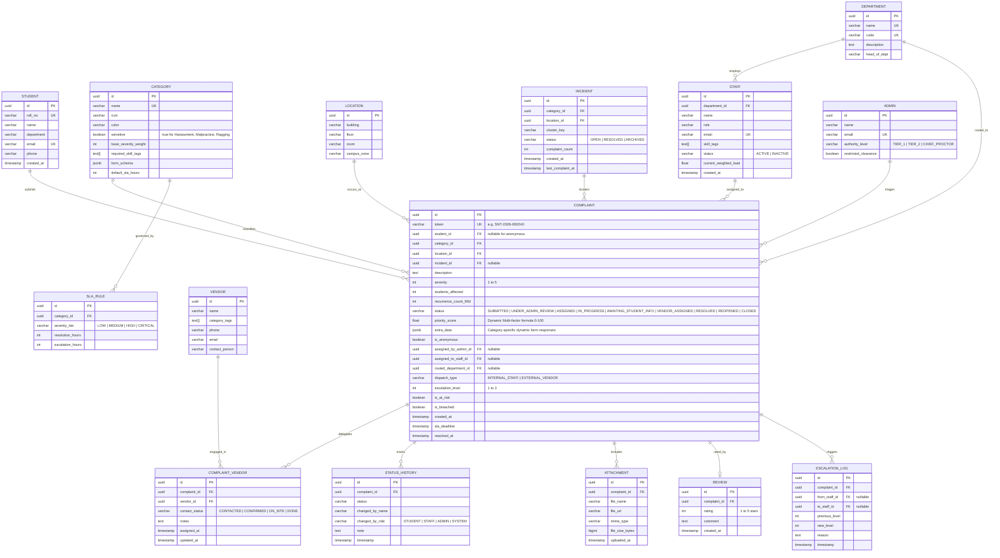

# FixLoop — Entity Relationship Diagram (ERD) & Database Schema

This document outlines the core relational database schema for FixLoop on PostgreSQL.

---

## 1. Entity Relationship Diagram



---

## 2. Core Relational Tables & PostgreSQL Constraints

### 2.1 Dynamic Form Schema & Response Handling (`JSONB`)
Categories define custom input requirements (e.g. room number, nature of ragging, lab device) using `JSONB` in the `category.form_schema` column:
```json
[
  { "key": "raggingType", "label": "Nature of Ragging", "type": "select", "required": true, "options": ["Physical", "Verbal", "Extortion", "Forced Acts"] },
  { "key": "immediateAssistanceNeeded", "label": "Immediate Assistance Needed?", "type": "boolean", "required": true }
]
```
Submissions store actual user values in `complaint.extra_data` without requiring DDL schema alterations.

### 2.2 Dynamic Priority Score Formula Implementation
Each complaint calculates priority dynamically according to:
$$\text{severity\_norm} = \frac{\text{severity}}{5}$$
$$\text{scale\_norm} = \frac{\ln(1 + \text{students\_affected})}{\ln(1 + 500)} \quad (\text{capped at 500})$$
$$\text{recurrence\_norm} = \frac{\min(\text{recurrence\_count\_last\_90\_days}, 10)}{10}$$
$$\text{time\_urgency\_norm} = \min\left(\frac{\text{hours\_since\_created}}{\text{sla\_hours}}, 1.0\right)$$
$$\text{priority\_score} = 100 \times \Big( (0.48 \times \text{severity\_norm}) + (0.21 \times \text{scale\_norm}) + (0.08 \times \text{recurrence\_norm}) + (0.23 \times \text{time\_urgency\_norm}) \Big)$$
